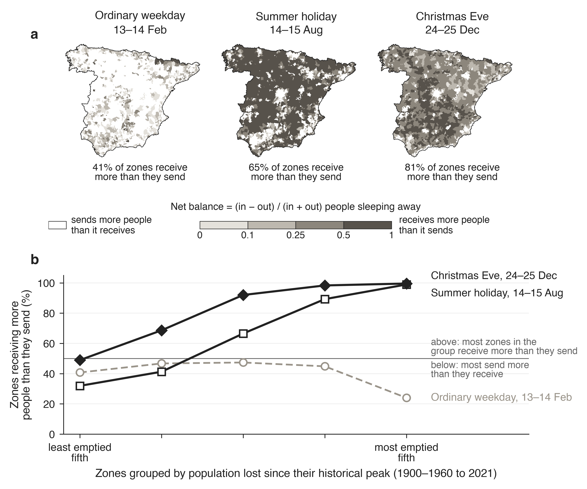

# Roots or beaches?

**When Spain goes on holiday, does it go back to the villages its families left?**

Between 1950 and 1975 millions of people moved from inland Spain to Madrid, Barcelona and the other big cities. This project uses mobile-phone estimates of where people spend the night to see whether holiday travel still follows the map of that rural exodus.

<p align="center">
  
</p>

## In short

- **The network changes shape on holidays.** On a mid-August night about four times as many residents sleep away from home as on an ordinary February weekday. Zones split into senders and receivers. Degree-preserving random networks show that most of the change in mixing follows from the degrees alone.
- **Cities send visitors to the provinces their residents were born in.** This holds on every night, after accounting for distance, income and the pair of provinces involved. The pull is strongest for people who moved before 1981 and for people born in villages.
- **The emptied interior fills up.** In the fifth of zones that lost most of their historical population, about one zone in four receives more people than it sends on an ordinary night. In mid-August almost all of them do.

## Read

| | |
|---|---|
| Coursework report (UCL COMP0123 *Complex Networks*) | [`reports/manuscript/output/main.pdf`](reports/manuscript/output/main.pdf) |
| Journal article, in preparation | branch [`journal`](https://github.com/aleetreny/spain-holiday-roots/tree/journal), folder `journal/` |

The journal version extends the coursework to 1,275 nights from 2022 to 2025. It pre-registers its tests and checks the August result on 2025 nights that had not been seen before.

## Data

All inputs are public. They are not stored in this repository.

| Source | Content |
|---|---|
| Spanish transport ministry (MITMA), [open mobility data](https://www.transportes.gob.es/ministerio/proyectos-singulares/estudios-de-movilidad-con-big-data/opendata-movilidad) | Daily overnight stays between 2,435 mainland zones, estimated from mobile phones |
| National Statistics Institute (INE) | Census residents by province of birth (table 68545), 2024 census microdata, historical municipal populations, household income, dwellings, phone-based tourism matrices |

## Repository layout

| Path | Contents |
|---|---|
| `pipeline/` | Main analysis: networks, network properties and null models, the villages result and the roots models. `config.py` fixes every choice. |
| `explore/` | Data downloads, data building and early exploratory scripts |
| `results/` | Tables and diagnostic plots written by `pipeline/` |
| `reports/` | Coursework report: LaTeX sources, figures and tables |
| `tests/` | Tests for the network metrics |

## Run

```sh
uv venv --python 3.12 && uv pip install -r requirements.txt
.venv/bin/python -I pipeline/b01_build_networks.py   # then the other pipeline/ steps
```

Raw data go in `data/`, `raw_data_cache/`, `clean_data/` and `_local/external/`. The download scripts are in `explore/` (`p80_*`, `p81_*`, `p83_*`, `p100_download_summer.py`).

## Licence and credits

Code under the [MIT licence](LICENSE). Text, figures and derived tables under [CC BY 4.0](https://creativecommons.org/licenses/by/4.0/).

Alejandro Treny Ortega, University College London. The project started as coursework for COMP0123 *Complex Networks*, taught by Prof. Shi Zhou.
