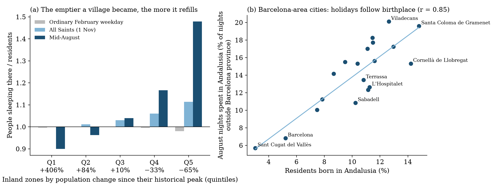

# Alternativas desde cero: ¿hay una pregunta más clara que la de 1833?

*24-nov-2026.*

*Fuentes:*
- *Exa: una comprobación de novedad de 8 ideas.*
- *Dos agentes de Antigravity (Gemini 4 Neon):*
  - *un ideador "a ciegas", que no vio nuestras ideas: 30 preguntas en 8 temas;*
  - *un rastreador de datos abiertos de España.*
- *OpenAlex y Consensus.*
- *Mis pilotos: `explore/p60`–`p74`.*
- *La candidata A (1833) queda documentada en `reports/propuesta_final.md` y es la referencia.*

## Veredicto

Sí hay una pregunta más clara y más humana que la de 1833, y además tiene datos y un hueco en la literatura.

> **¿Sigue el éxodo rural dibujando el mapa de las vacaciones en España?**
>
> *EN: Does the rural exodus of the 1950s–70s still draw Spain's holiday map?*

**La respuesta de los pilotos es sí, por los dos lados de la red:**
- **Los pueblos.** Entre los municipios de interior, cuanto más se vació un pueblo desde su máximo histórico, más se llena en vacaciones. Los que perdieron el 65 % de su población tienen **×1,48 personas durmiendo allí a mediados de agosto** y ×1,11 en Todos los Santos. Los que crecieron, ×0,90. Un martes de febrero, todos están en ×1,0.
- **Las ciudades.** Comparando ciudades vecinas, la gente duerme en vacaciones donde nacieron sus vecinos: la elasticidad es de **0,72** (un 10 % más de nacidos en una provincia supone un 7 % más de noches allí). En el área de Barcelona, el porcentaje de vecinos nacidos en Andalucía predice las noches de agosto pasadas en Andalucía con **r = 0,85**. Santa Coloma tiene un 15 % de nacidos en Andalucía y pasa allí el 20 % de esas noches; Sant Cugat, un 3 % y un 6 %.

**Mi recomendación honesta:**
- Con las prioridades que has fijado (claridad, unicidad y wow), **esta pregunta (B) pasa a ser la favorita**, siempre que supere cuatro comprobaciones de pocos días (§6).
- **La candidata A (1833) sigue siendo la más robusta y la más original.** No la tiraría.
- Las dos son caras de la misma idea, "la red de movilidad de España recuerda su historia", y juntas darían un paper muy bonito (§5).

---

## 1. Por qué la de 1833 parece "rebuscada" (diagnóstico)

- **La pregunta es clara; la explicación no.** Para entender por qué importa hace falta una lección de historia (qué pasó en 1789 y en 1833), y la prueba que la sostiene es un razonamiento en cadena (fronteras nuevas, antiguas y borradas, con un modelo nulo espacial y bandas de tiempo de viaje).
- **Su núcleo es una regresión de "efecto frontera".** La parte de red (la carrera de mapas por modularidad y los nulos) es de apoyo. Para COMP0123 puntúa más una pregunta cuya respuesta es en sí una propiedad de red.
- **Qué pide un 10.** Una pregunta que entienda cualquiera en una frase, sin lección previa; una respuesta no obvia; una figura que se recuerde; y que España sea el mejor laboratorio del mundo para contestarla.

## 2. Principios básicos: dónde España es un laboratorio único

1. **Éxodo rural de 1950–75 y "España vaciada".** El interior tiene densidades de población por debajo de las de Laponia, y existe la institución cultural de "el pueblo".
2. **Segundas residencias.** España tiene la mayor proporción de la UE, muchas heredadas en el pueblo.
3. **Un dato abierto casi único en el mundo.** El MITMA publica cada día, municipio a municipio, **dónde duermen los residentes de cada distrito** (pernoctaciones, 2022–2025). Hasta ahora no lo habíamos usado.
4. **Infraestructura radial** (km 0, AVE en estrella), **municipios muy fragmentados**, **turismo de masas** e **identidades regionales**. Estos ejes ya los exploré con la candidata A.

Medida directa del fenómeno (pernoctaciones de 2024, 180 noches):

| Noche | Duermen fuera de su municipio | En otra provincia |
|---|---|---|
| Martes–jueves de febrero | 4,7 % | 2,4 % |
| Sábado ordinario (mediana) | 8,8 % | 4,9 % |
| Sábado de Semana Santa | 17,3 % | 12,0 % |
| **18 de agosto** | **21,8 % (10,5 millones)** | **14,8 % (unos 7 millones)** |

## 3. El embudo: de 60 ideas a 2 finalistas

He juntado 30 ideas mías y 30 del ideador a ciegas, eliminando duplicados. He pilotado con datos las que pasaban el primer filtro.

| Idea | Qué pasó | Decisión |
|---|---|---|
| **B. Éxodo rural y vacaciones** | Gradiente pueblo a pueblo; elasticidad de 0,72 entre ciudades vecinas; r = 0,85 en el área de Barcelona | **Finalista** |
| **Territorios de verano** (n.º 1 del ideador): ¿tiene cada ciudad su propia playa? | Hay "colonias" más allá de la distancia: Zaragoza en Salou (×7), Logroño en Salou (×7) y Vitoria en pueblos de Cáceres a 500 km (×23). La concentración global es solo un 30 % mayor que la del nulo, y las comunidades bipartitas con nulo espacial salen ruidosas | **Integrada en B** como análisis de red: las colonias lejanas son raíces |
| **AVE "captura de órbita"** (n.º 2 del ideador) | Tras Pajares, Madrid–Asturias creció un 24 % frente al 10 % típico (puesto 3 de 51; p ≈ 0,06 por placebo). En Murcia, ningún efecto. Es un solo corredor, pide unos 3 años de datos diarios y no es nativo de redes | Descartada como principal |
| **Club de los ricos en agosto** (n.º 3 del ideador) | ρ(k) entre 1,0 y 1,5 todos los días; los centros no cambian (solo Benidorm entra en el top 12) | Descartada: no hay inversión |
| **Talón de Aquiles** | Aunque quites 400 municipios (los de más grado, más intermediación o al azar), la red no se rompe; es como una malla espacial | Descartada |
| "Los festivos siguen el lugar de nacimiento" a nivel de provincia | Se cumple, pero los vínculos de nacimiento explican el 40 % de los viajes también un martes cualquiera. Sería una respuesta obvia | Corregida en B con el diseño de ciudades vecinas y el gradiente de los pueblos |
| Mezcla política, club de ricos por renta, apagón eléctrico | Ya hechas o muy cerca: Liang & Cho 2026; Duran-Sala et al. 2024 (con datos MITMA); física del apagón saturada y sin datos MITMA del 28–29 de abril de 2025 | Descartadas |
| Contratos menores (PLACSP) | Interesante, pero requiere 2 o más semanas de ingeniería de datos y tiene un riesgo de acusaciones sensible | Comodín fuera de la movilidad |
| Despoblación y voto; migración frente a commuting; percolación; "¿es Cataluña una isla?" | Ya existen análogos: Sánchez-García et al. (EJPR); Wolff 2024; Arcaute 2016. La de Cataluña es un subcaso de A, políticamente delicado | Descartadas |

## 4. La finalista B, en detalle

**Pregunta**
- **ES:** ¿Sigue el éxodo rural dibujando el mapa de las vacaciones en España?
- **EN:** Does the rural exodus of the 1950s–70s still draw Spain's holiday map?
- **Versión técnica:** ¿predice la red migratoria histórica la red de pernoctaciones en vacaciones, más allá de la distancia, el tamaño y la playa? Esa red migratoria tiene dos piezas: dónde nació cada residente y cuánto se vació cada municipio. El contraste se hace con un nulo de configuración espacial (gravedad doblemente restringida) y con noches ordinarias como placebo.

**Evidencia piloto**

| # | Resultado | Número | Robustez provisional |
|---|---|---|---|
| 1 | Los pueblos que más se vaciaron son los que más se llenan | Quintil de mayor pérdida (−65 %): ×1,48 en agosto y ×1,11 en Todos los Santos; quintil que creció: ×0,90; en febrero, todos ×1,0. Con efecto fijo de provincia y control de tamaño, +0,55 log (ee 0,05) | Se mantiene dentro de cada tercil de tamaño (pequeños 0,98→1,45; medianos 0,97→1,52) |
| 2 | Todos los Santos separa las raíces del turismo | Las zonas que agrupan pueblos pequeños de interior (Burgos, Segovia, Zamora, Huesca) duplican la gente que duerme allí (×1,6–2,1). Las playas (Peñíscola, Oropesa) se quedan en ×1,0–1,2, aunque en agosto lleguen a ×4–5 | Es un día de visita a cementerios, no de playa |
| 3 | Las ciudades vecinas veranean donde nacieron sus vecinos | Elasticidad de 0,72 en agosto y 0,63 en febrero, con efectos fijos por par provincia de origen × provincia de destino, es decir, comparando ciudades a la misma distancia | Se basa en 151 ciudades con el lugar de nacimiento del Censo 2024 |
| 4 | Ejemplo visual | Área de Barcelona: r = 0,85 entre el % de nacidos en Andalucía y el % de noches de agosto en Andalucía. Por distritos: Sarrià 3,7 %, frente al 13–16 % de Santa Coloma, Sant Boi, Badalona y Mataró | ⚠️ Está confundido con la renta: en Madrid no se cumple, porque Andalucía es su playa y los municipios ricos van más |
| 5 | "Colonias" lejanas que la distancia no explica | Vitoria en pueblos de Cáceres (×23, a 500 km); L'Hospitalet y Cornellà en la costa de Granada; Valencia en pueblos de Cuenca (×8,5) | Las comunidades bipartitas con nulo espacial agrupan por raíces, aunque son ruidosas |

**Por qué es de *Complex Networks* (y cómo contarlo para Shi Zhou)**
- **Tres redes sobre los mismos nodos:**
  - la red cotidiana (viajes en día laborable);
  - la red de vacaciones (dónde duerme cada residente en agosto, Todos los Santos y Navidad);
  - la red de raíces (dónde nació la gente frente a dónde vive).

  El profesor recomienda expresamente comparar redes.
- **Propiedades básicas de cada red:** grado, asortatividad, *rich-club* normalizado y k-core.
- **Red bipartita ciudad × destino.** Modularidad bipartita con dos nulos: el BiCM (sin espacio) y la gravedad doblemente restringida (con espacio). Sale el "mapa de los territorios de verano", donde las comunidades que no son contiguas son las diásporas.
- **Nodo a nodo:** el "rellenado" del pueblo frente a la pérdida histórica.
- **Enlace a enlace:** la red de vacaciones frente a la de raíces, comparando ciudades vecinas.
- **Placebos temporales:** martes de febrero, sábado ordinario, Todos los Santos y agosto.

**Literatura (novedad)**
- **Lo más cercano:**
  - INE EM-1 (2020) mide la población estacional con móviles.
  - El INE publica desde 2019 los turistas por municipio de origen y de destino. Lo han usado Sánchez-Martín (2026, *Land*, solo flujos con origen en Madrid) y Garzón-Paredes & Royo-Vela (2026, patrimonio y redistribución estival).
  - Osorio Arjona (2024, *Sci Rep*): fines de semana en la Andalucía rural.
  - China: los viajes del Año Nuevo frente a la migración actual (Li et al. 2016, QAP).
  - Wesolowski et al. (2017, *Nat Commun*): la asimetría estacional de los viajes.
  - Turismo de diáspora y "retorno" (King & Christou 2011; Huang et al. 2018).
  - Vinuesa (2005): la población vinculada.
- **El hueco.** No encontramos ningún trabajo que una la red nacional de pernoctaciones en vacaciones con el éxodo histórico (cuánto se vació cada pueblo y dónde nació la gente) usando un nulo espacial y comparando ciudades vecinas. Exa la califica de "PARTIAL" (hay análogos, sobre todo en China) y el ideador de "GAP" (en su versión de territorios de verano). Los chinos estudian a migrantes actuales; aquí son los hijos y nietos, 50–70 años después.
- **Pregunta universal para un lector internacional:** *¿cuánto dura el eco de una migración en una red de movilidad?*

**Riesgos y cómo cerrarlos**
1. **Renta.** Los barrios con más inmigración interna son más pobres. Solución: añadir la renta de cada ciudad del Atlas de Renta del INE con efectos fijos de destino por renta, y comparar distritos de renta similar.
2. **Playa.** Se controla con el efecto fijo de destino, con submuestras solo de interior y con Todos los Santos como día sin playa.
3. **Definición de residencia del MITMA.** Quien pasa todo agosto en el pueblo podría ser reasignado a él. Eso sesga en contra del hallazgo, así que el efecto real sería mayor.
4. **Un solo año.** Replicar con agosto de 2022 y 2023 (descarga barata) y con la estadística experimental de turismo del INE (2019–2025, tres operadoras: una fuente independiente).
5. **Distancia en línea recta.** Ampliar la matriz de tiempos por carretera de OpenStreetMap a las 151 ciudades frente a todos los destinos.

## 5. A frente a B, y la opción de juntarlas

| Indicador | A · fronteras de 1833 | B · éxodo y vacaciones |
|---|---|---|
| Claridad de la pregunta | 9 | **9,5** |
| Claridad de la explicación | 7 (requiere historia) | **9,5** |
| Unicidad | **9** | 8,5 |
| Wow | 9 | 9 (más emocional) |
| Encaje con COMP0123 | 8 | 8 (tres redes, bipartita, placebos) |
| Robustez hoy | **9** | 7 (pendiente de controlar la renta y de replicar) |
| Datos y viabilidad | **10** (hecho) | 9 (casi todo en disco) |
| Publicable | 8–8,5 | 8 |

**Opción para el paper: "Las dos memorias de la red española".**
- Un día laborable, España se mueve dentro del mapa de 1833: la memoria del Estado.
- En vacaciones, vuelve por las rutas del éxodo: la memoria de la familia.

Ya tenemos una pista de esa disociación: la frontera provincial se debilita el fin de semana (×1,42 frente a ×1,26) y las raíces se refuerzan en festivos. Para la asignatura conviene una sola pregunta; esto quedaría para el paper.

## 6. Próximos pasos (solo si eliges B)

1. Controlar por renta en el modelo de ciudades vecinas y en los distritos de Barcelona y Madrid. Es la prueba decisiva.
2. Replicar en agosto de 2022 y 2023 (MITMA) y con la estadística de turismo móvil del INE (2019–2025).
3. Hacer el mapa de "territorios de verano" con modularidad bipartita, nulo espacial y BiCM.
4. Calcular tiempos por carretera de larga distancia para las 151 ciudades.
5. Pasar una revisión adversaria independiente antes de escribir.

## Archivos

- Scripts: `explore/p60`–`p74`.
- Notas de los agentes y de Exa: `research_notes/Preguntas alternativas desde cero/`.
- Registro: `.planning/2026-11-24-first-principles-alternatives/findings.md` (Q1–Q13).
- Datos nuevos:

| Dato | Dónde |
|---|---|
| Pernoctaciones municipales de 2024 (6 meses) | `_local/external/mitma_pernoct/`, `data/derived/pernoct_mun_2024_6m.parquet` |
| Lugar de nacimiento × residencia (provincias 1998–2025; 151 ciudades 2021–2025) | `_local/external/ine_birth_residence/` |
| Población municipal 1842–2025 | `_local/external/ine_historical_pop/` |
| Migración interprovincial 1988–2024 | `_local/external/ine_interprovincial_migration/` |
| Índice de amistades de Facebook (provincias) | `_local/external/meta_sci_spain/` |
| Estaciones de AVE | `_local/external/spain_hsr_stations/` |
| Matrices origen-destino de octubre de 2022 y 2023 | `data/od_matrices_daily/2022`, `data/od_matrices_daily/2023` |

**Notas del rastreador de datos** (`research_notes/Preguntas alternativas desde cero/neon_data_scout.md`)
- **Datos validados:** las matrices de nacimiento × residencia cuadran con los totales nacionales del INE persona a persona.
- **Migraciones interprovinciales 1988–2024:** son 37 años seguidos. Sirven para una prueba extra de B: ¿predicen mejor las vacaciones de hoy los flujos migratorios antiguos (1988–1995) que los recientes? Eso mediría el "eco" de la migración.
- **Amistades de Facebook (índice SCI de Meta, 2026):** valen como tercera red de vínculos, para comprobar si las vacaciones siguen a los amigos o al lugar de nacimiento.
- **Estaciones de AVE:** 59, con su fecha de apertura.
- **Elecciones municipales de 2023:** no se pudieron descargar, porque la web del Ministerio del Interior bloquea las descargas automáticas. Habría que bajarlas a mano desde el navegador; no hacen falta para A ni para B.
